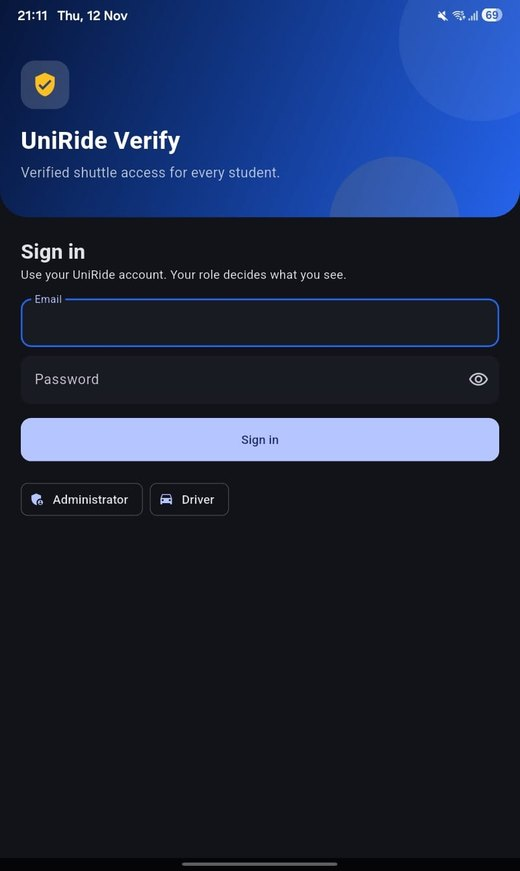
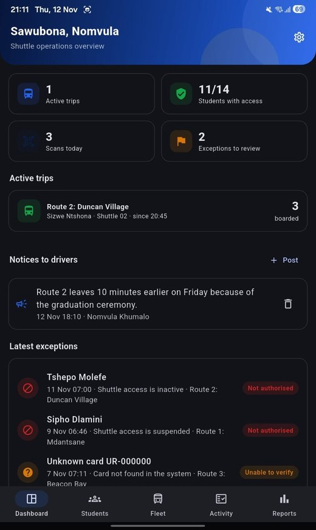
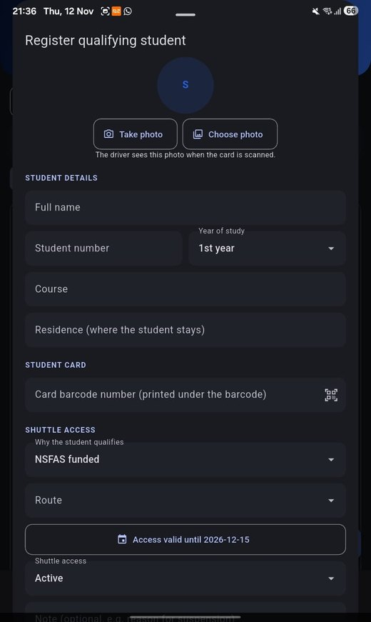
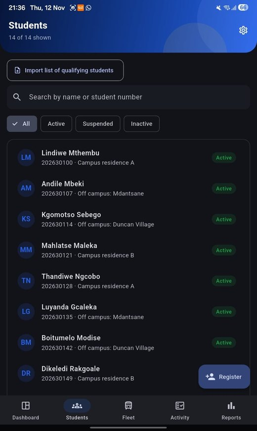
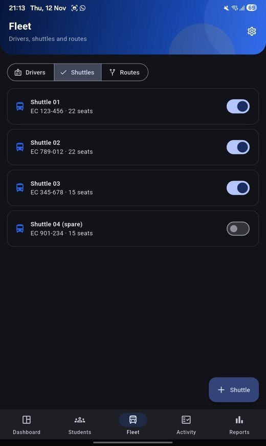
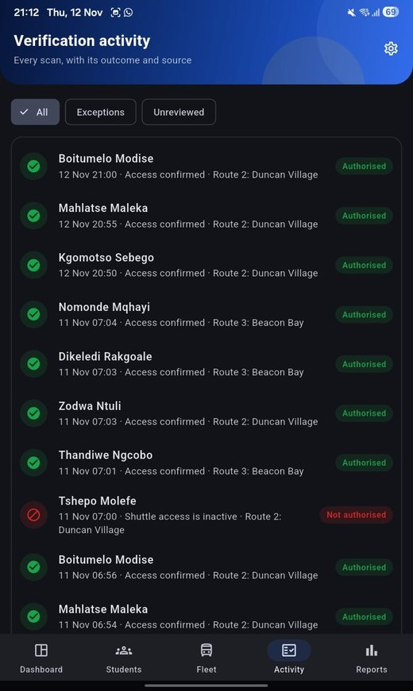
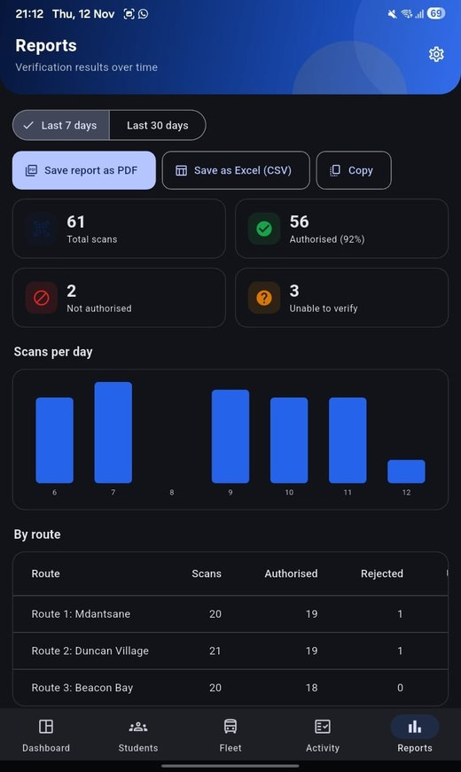
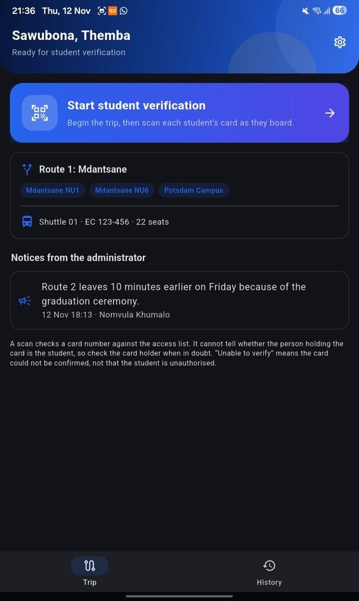
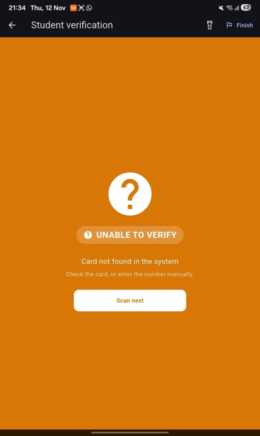
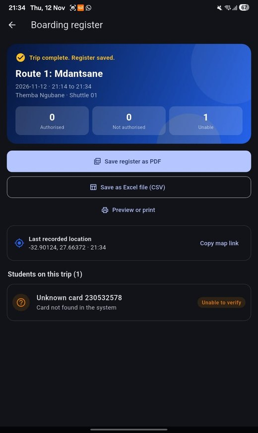

# UniRide Verify

**Verified shuttle access for every student.** A Flutter mobile app that lets a university administrator register the students who qualify for school transport, and lets shuttle drivers scan student cards at the door to confirm who may board. Every trip ends with a boarding register that can be saved as a PDF or an Excel file.


-orange)

> Academic project for **Application Technology IV (APT 41P2)**, Walter Sisulu University. The app uses fictional sample data and stores it only on the device.

---

## Contents
- [Screenshots](#screenshots)
- [The problem](#the-problem)
- [Features](#features)
- [How a scan is decided](#how-a-scan-is-decided)
- [Tech stack](#tech-stack)
- [Project structure](#project-structure)
- [Getting started](#getting-started)
- [Platform setup](#platform-setup)
- [Sample accounts and walkthrough](#sample-accounts-and-walkthrough)
- [Data, privacy and limitations](#data-privacy-and-limitations)
- [Roadmap](#roadmap)
- [Author](#author)

## Screenshots
| Sign in | Administrator dashboard | Register a student | Students list | Fleet |
|---|---|---|---|---|
|  |  |  |  |  |

| Activity | Reports | Driver home | Scan result | Boarding register |
|---|---|---|---|---|
|  |  |  |  |  |

## The problem
Campus shuttles have a limited number of seats and are meant for students who qualify (for example NSFAS-funded students or students who live off campus). Without a quick check at the door, a driver cannot tell who qualifies, seats are taken by people who should not be on board, and nobody keeps a record of who travelled. UniRide Verify gives the administrator one list of qualifying students and gives the driver a fast, camera-based check with a photo, so the decision takes a few seconds and every trip leaves a record.

## Features

### Administrator
- **Register qualifying students** with photo, full name, student number, year of study, course, residence, the number printed under the barcode on the student card (a scan button reads it with the camera), the reason the student qualifies, route, and the date access is valid until.
- **Import a list** of qualifying students by pasting rows (copied from Excel works).
- **Access control:** suspend or reactivate a student. Access ends automatically on the valid-until date.
- **Fleet management:** drivers, shuttles (with seat counts) and routes, plus driver assignments.
- **Dashboard:** active trips (with the last GPS position), students with access, scans today, exceptions to review, and notices to drivers.
- **Activity and review:** every scan with its outcome; exceptions can be reviewed with a note.
- **Reports:** results for the last 7 or 30 days, results by route, and exports as **PDF**, **Excel (CSV)** or copied text. Every trip's boarding register can be opened and downloaded.

### Driver
- **Start student verification** from the home screen. The trip starts and the scanner opens.
- **Scan the student card.** The result fills the screen: green (authorised), red (not authorised) or amber (unable to verify), with the student's photo, name, number, course, year and residence. A manual entry box works when a card is damaged.
- **Live counters** for boarded, refused and unable, plus a warning when the shuttle is already full.
- **Finish and save the register.** The trip ends and the boarding register (date, times, route, vehicle, driver, each student with photo, residence, time, result and GPS position) is saved. Download it as a **PDF** or **Excel (CSV)** file, or open the print preview.
- **History** of earlier trips and their registers, and **notices** from the administrator.

### Mobile features used
| Feature | Where it is used |
|---|---|
| Camera (barcode / QR scanning) | Driver scanner; admin card-number capture |
| Camera and gallery (photos) | Student photo at registration |
| GPS location | Each scan is stamped with the driver's position; last position shown to the administrator |
| Haptic feedback | Different vibration for authorised and refused scans |
| In-app alerts | Notices to drivers, full-shuttle warning, expired-access refusal |
| File sharing / printing | PDF and Excel registers and reports via the system share sheet |
| Local storage | Works offline; data kept on the device |

## How a scan is decided
The scanner reads the value on the card (the barcode number, the student number, or the pass QR code) and checks, in order:

1. **Unknown card** gives *Unable to verify*.
2. Student **suspended or inactive** gives *Not authorised*.
3. Access **expired** gives *Not authorised*.
4. Student belongs to **another route** gives *Not authorised*.
5. Student **already scanned on this trip** is flagged as a duplicate and is not counted twice.
6. Otherwise *Authorised*. If the shuttle is already at capacity the driver is warned.

A scan only checks a number against the list. It cannot prove that the person holding the card is the student, which is why the photo is shown for the driver to compare.

## Tech stack
| Area | Choice |
|---|---|
| Framework | Flutter (Material 3), Dart 3.4+ |
| Scanning | `mobile_scanner` |
| Photos | `image_picker` |
| Location | `geolocator` |
| PDF and printing | `pdf`, `printing` |
| File sharing | `share_plus` |
| QR pass | `qr_flutter` |
| Storage (local sample data) | `shared_preferences` (JSON on the device) |

## Project structure
```
uniride_verify/
├── lib/
│   ├── main.dart       # All screens and widgets (login, admin pages, driver pages, scanner, register page)
│   ├── data.dart       # Data store, sample data, verification rules, students, trips, reports (CSV)
│   ├── register.dart   # Boarding register and report generation (PDF and CSV) and sharing
│   └── location.dart   # GPS helper (never blocks scanning if location is off)
├── pubspec.yaml
└── README.md
```

## Getting started

**Requirements:** Flutter 3.22 or newer (Dart 3.4+), Android Studio or VS Code, an Android phone or emulator, and Chrome for the web version.

```bash
git clone https://github.com/omphileM-Tlholatlung/uniride-verify.git
cd uniride-verify
flutter create .        # only if the android/ and web/ folders are missing
flutter pub get
flutter run             # Android phone or emulator
flutter run -d chrome   # administrator on the web (wide layout)
```

## Platform setup
The platform folders are generated by `flutter create .`. Then add the permissions below.

**Android** (`android/app/src/main/AndroidManifest.xml`, inside `<manifest>`, above `<application>`):
```xml
<uses-permission android:name="android.permission.CAMERA" />
<uses-permission android:name="android.permission.ACCESS_FINE_LOCATION" />
<uses-permission android:name="android.permission.ACCESS_COARSE_LOCATION" />
<uses-feature android:name="android.hardware.camera" android:required="false" />
```
In `android/app/build.gradle` (or `build.gradle.kts`) set `minSdk` to **23** or higher.

**iOS** (`ios/Runner/Info.plist`): add `NSCameraUsageDescription`, `NSPhotoLibraryUsageDescription` and `NSLocationWhenInUseUsageDescription` with a short reason for each.

**Web:** the camera and location work on `localhost` or over HTTPS only. Chrome offers *Choose photo* (gallery) but not *Take photo*.

## Sample accounts and walkthrough
Password for every sample account: `UniRide@2026`.

| Role | Email |
|---|---|
| Administrator | `admin@uniride.demo` |
| Driver (Route 1) | `themba@uniride.demo` |
| Driver (Route 2) | `sizwe@uniride.demo` |

**Five-minute walkthrough**
1. Sign in as the **administrator**. Open **Students** and tap **Register**. Add a photo, the details, and use the scan button next to *Card barcode number* to read the barcode on a real student card. Choose **Route 1** and save.
2. Open **Dashboard**, post a **notice** to drivers.
3. Sign out and sign in as **Themba** (Route 1 driver). The notice is on the home screen.
4. Tap **Start student verification**. Scan the card you just registered: the screen turns green with the photo.
5. Scan or type `UR-201096` (suspended student, red) and `UR-000000` (unknown card, amber).
6. Tap **Finish**, then **Save register as PDF** and **Save as Excel file (CSV)**.
7. Sign in as the administrator, open **Reports**, and export the report or open the trip's boarding register.

Sample cards: `UR-200000` authorised, `UR-201096` suspended, `UR-201507` access expired (Route 1), `UR-000000` unknown. **Settings > Reset saved data** removes everything you added and restores the sample data.

## Data, privacy and limitations
- This app uses local sample data. Data is stored in the browser or phone storage with `shared_preferences`; the administrator and driver must therefore use the same device to see the same data. The shared password is not secure.
- The app holds personal information (names, student numbers, photos, residence, location). A production version must follow the **Protection of Personal Information Act 4 of 2013 (POPIA)**: collect only what is needed, keep it secure, and tell students why it is collected. Photos are shown only to the driver while a card is scanned.
- Do not commit real student photos, card numbers or exported registers to a public repository. The sample data in this repository is fictional, and `.gitignore` excludes `.pdf`, `.csv` and image files.
- A scan cannot confirm that the card holder is the student; the driver compares the photo.

## Roadmap
- Firebase (Authentication, Firestore, Storage) so the administrator and drivers share live data and each user has a private login.
- Push notifications for notices and alerts.
- Live map of active shuttles for the administrator.
- Offline queue that syncs scans when the connection returns.
- Student-facing notifications about their access status.

## Author
**Tlholatlung Omphile Mildred**, Advanced Diploma in ICT (Applications Development), Walter Sisulu University. GitHub: [omphileM-Tlholatlung](https://github.com/omphileM-Tlholatlung)
